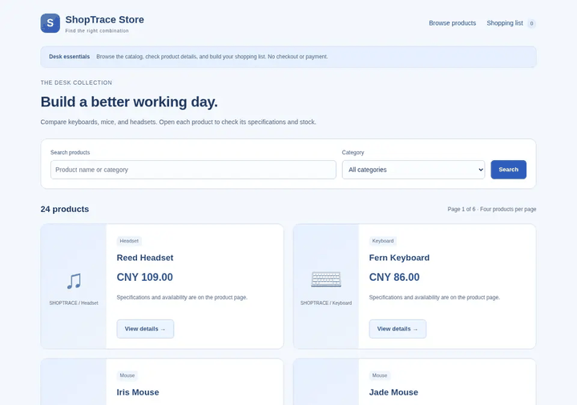

# ShopTrace

ShopTrace is a browser agent for shopping tasks. A language model controls a real Chromium page through a small set of DOM tools, one action per turn, and every observation, action, screenshot, and result is stored for replay.

**Replay:** <https://zhengjiabei1.github.io/shopping_agent/>  
[Review guide (Chinese)](docs/REVIEW_GUIDE.zh-CN.md)



## What it does

- **DOM-grounded browser loop.** Playwright extracts visible text and interactive elements; the model returns exactly one `click`, `fill`, `select`, `press`, `scroll`, `back`, `wait`, or `finish` call. Element references come from the latest observation, so stale references are rejected.
- **Three task sets.** Six base tasks on a 12-product store, twelve development and held-out cases with eight products each, and ten cross-page procurement tasks on a 24-product store with controlled add-to-cart faults.
- **Replayable traces.** SQLite stores each step, screenshot, action, error, and memory event. The static portal replays a run without a backend.
- **Bounded execution.** Origin and path allowlists, read-only external tasks, one browser context per run, step/time/token/context budgets, cancellation, and a source fingerprint that stops a run if the server changes underneath it.

## Results

Runs use DeepSeek `deepseek-flash` at temperature 0. Synthetic tasks allow 35–70 steps and 180 seconds; external tasks allow 50 steps and 240 seconds.

| Evaluation | Result |
|---|---|
| Six base tasks, five runs each | 30/30 passed |
| Procurement held-out | 7/8 passed, 1 unknown |
| External read-only slice | 12/30 passed, 14 failed, 4 unknown |
| Test suite | 256 tests |

The external slice is a 30-task subset of WebVoyager. The clean-site subset passed 10/15; the full set includes Allrecipes (blocked) and GitHub/Coursera (degraded without CDN assets). It is manually graded and read-only, so it is not a WebVoyager leaderboard result.

The procurement held-out run is the main capability check: eight unseen constraint combinations in the same store, seven passes and one cancelled run left unknown. The six base tasks are small by design; the 30/30 result checks the harness and pages, not general web competence.

## Scope and limitations

- The store is synthetic (12–24 products). It has no login, checkout, payment, coupon, return, or multi-tab flow.
- Samples are small: eight held-out cases, 30 external tasks, and two attempts per context setting. The numbers are engineering measurements, not statistics.
- There is no baseline agent comparison. The project compares context and recovery settings, not ShopTrace against another agent or a human.
- External tasks are read-only and can still trigger side effects through GET requests; results need review.
- Page memory and recovery are prompts and a text cache, not a learned policy.

## Run it

Python 3.11+ and Chromium are required.

```bash
python3 -m venv .venv
source .venv/bin/activate
python -m pip install -r requirements-webagent.txt
python -m playwright install chromium
python -m webagent doctor
python -m webagent serve --port 8775
```

Open <http://127.0.0.1:8775>. Set `LLM_BASE_URL`, `LLM_MODEL`, and, when required, `LLM_API_KEY` on the server before running a model task. The key never enters the browser or the trajectory.

```bash
python -m webagent tasks
python -m webagent run --task-id browser-thermos-variant --provider api
python -m webagent procurement --split development
```

The static report is in `portal/dist/`:

```bash
python -m http.server 8790 --bind 127.0.0.1 --directory portal/dist
```

## Tests

```bash
WEBAGENT_CHROMIUM_PATH="/path/to/chrome" python -m unittest discover -s tests
```

The suite covers the browser boundary, stale references, origin and path rules, budgets, cancellation, storage, task grading, procurement faults, model protocol errors, the portal builder, and deployment templates. Browser tests skip when Chromium is not configured.

## Repository map

```
webagent/      browser loop, DOM observation, tasks, procurement, page memory
lab/           SQLite storage, model client, evaluation helpers
portal/        static replay viewer and report builder
benchmarks/    external benchmark manifest and read-only slice
tests/         unit and browser tests
```

Architecture: [docs/ARCHITECTURE.md](docs/ARCHITECTURE.md). Evaluation details: [docs/EVALUATION.md](docs/EVALUATION.md). External benchmark: [docs/EXTERNAL_BENCHMARK.md](docs/EXTERNAL_BENCHMARK.md). Running and deployment: [docs/RUNNING.md](docs/RUNNING.md), [docs/DEPLOYMENT.md](docs/DEPLOYMENT.md).

AI assistants were used for implementation and copy editing.

## License

MIT. See [LICENSE](LICENSE). Third-party notices are in [THIRD_PARTY_NOTICES.md](THIRD_PARTY_NOTICES.md).
