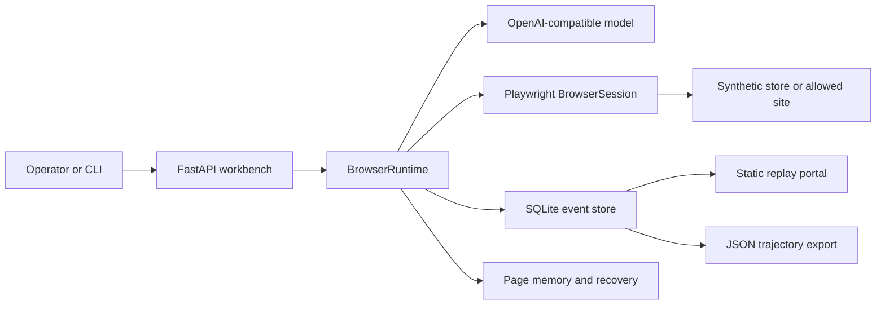

# Architecture

ShopTrace is a single-process Python application with a static replay viewer. The workbench owns the browser, the model client, and the event store. The portal is a read-only view over saved events.

## Components

| Path | Responsibility |
|---|---|
| `webagent/app.py` | HTTP API, run queue, source fingerprint, same-origin and host checks, disk guard |
| `webagent/runtime.py` | Tool loop, observation compaction, budgets, progress guard, cancellation |
| `webagent/browser.py` | Single-tab Playwright session, DOM observation, action checks, origin and path scope |
| `webagent/tasks.py` | Synthetic tasks and server-side grading |
| `webagent/cases.py` | Development and held-out cases with separate catalogs |
| `webagent/procure.py` | Cross-page procurement tasks and controlled add faults |
| `webagent/memory.py` | Bounded page text cache with observation provenance |
| `webagent/recovery.py` | Visible-state guidance for procurement |
| `lab/models.py` | OpenAI-compatible model client and provider profiles |
| `lab/storage.py` | SQLite runs, events, screenshots, annotations |
| `portal/` | Static report builder and replay viewer |
| `benchmarks/external/` | Read-only WebVoyager manifests, grades, and protocol |

## One model turn

1. The browser returns an observation: URL, title, visible text, interactive elements, and a screenshot name.
2. The runtime compacts the observation for the model if it exceeds 60k characters. The full observation remains in storage.
3. The model receives the compact observation, the action journal, the task, and the closed tool schema.
4. The runtime accepts exactly one function call per turn and validates its fields.
5. The browser executes the action, checks scope, and returns the next observation.
6. The runtime records the action, the observation, errors, memory events, and progress state.

## Execution boundaries

- One isolated browser context per run.
- Explicit origin and path allowlists; external tasks are read-only.
- Popups, downloads, file inputs, arbitrary scripts, and out-of-scope navigation are blocked.
- Step, time, token, and serialized-context budgets; cancellation is checked between operations.
- The API binds to loopback by default and applies same-origin and trusted-host checks.

## Evidence model

`runs` stores the run summary; `events` stores the ordered record. Event types include `observation`, `action`, `model_request`, `model_response`, `error`, `model_observation`, `progress`, `browser_recovery`, `memory`, `recovery`, and `evaluation`.

Screenshots are stored per run. The portal builder copies the selected fields into `report.json` and `report-data.js`; raw traces are gzip-compressed. Rebuilding the portal does not call a model or a browser.

## Scope

No checkout or payment, no training or RL, no multi-tab browsing, and no claim that the synthetic tasks measure general web competence. The external slice is a separate read-only path with the same browser session and runtime; it is manually graded.
